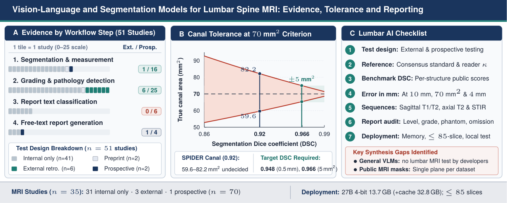
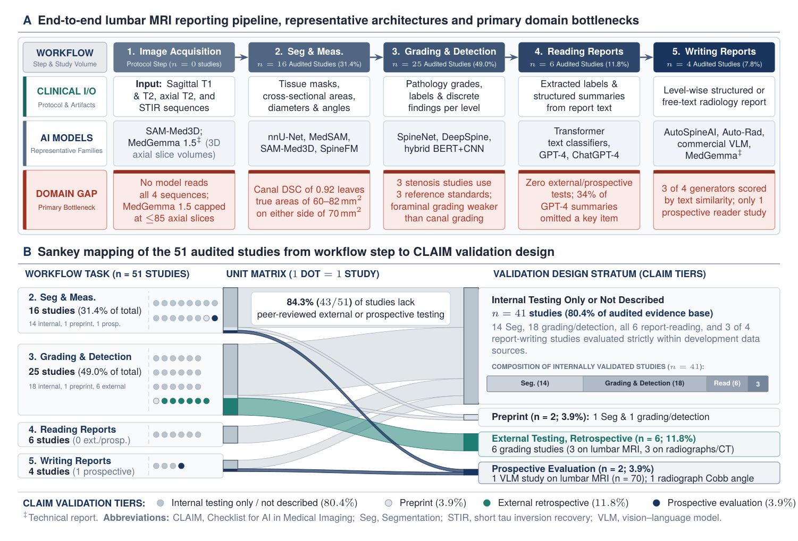
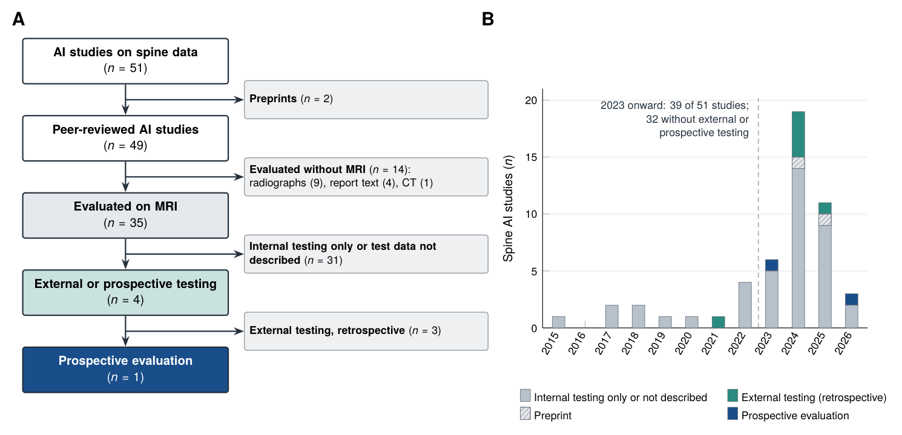
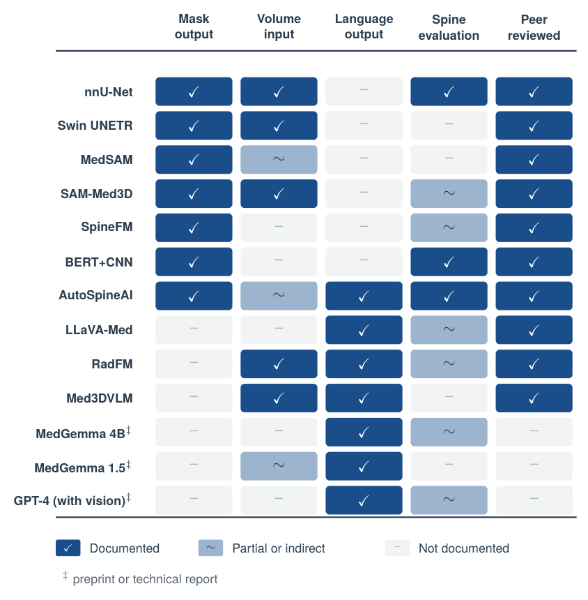
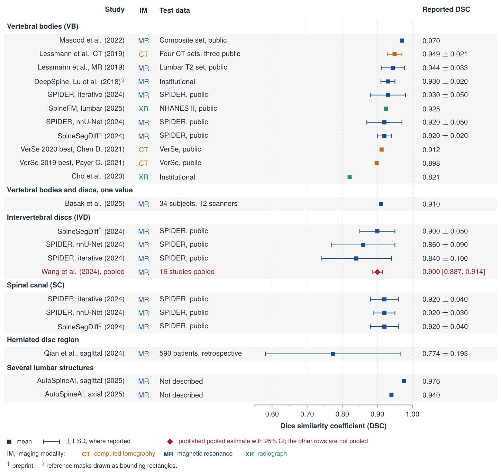
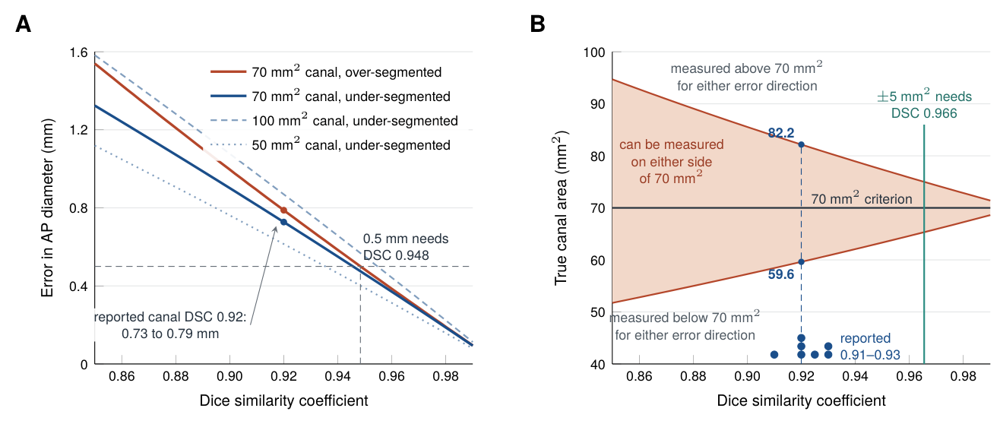
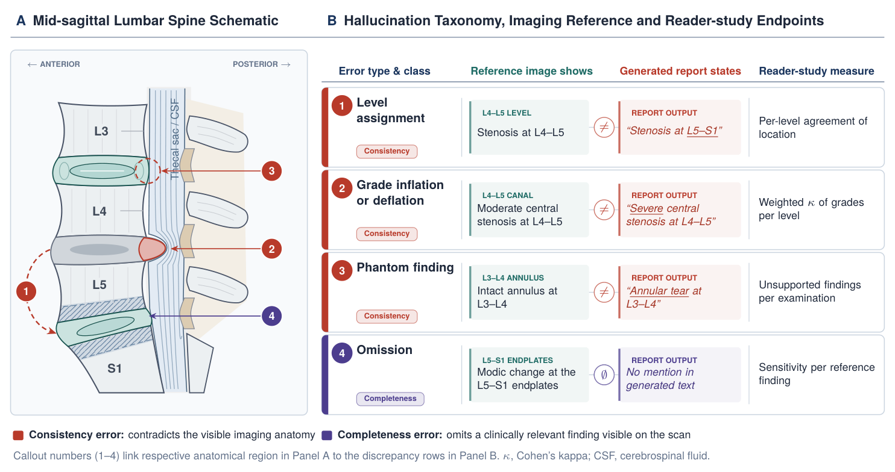
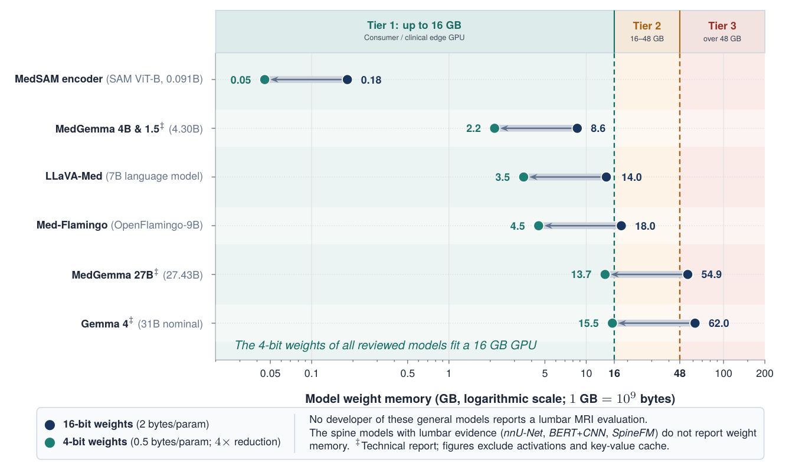

# Vision-language models for lumbar spine MRI: evidence, test design and measurement tolerance

Data and analysis code for the review article

> **Vision-Language Foundation Models for Lumbar Spine Diagnostics: A Methodological Review of Architectures, Validation Evidence and Deployment Pathways.** Under review at the *European Journal of Radiology*.

The repository summarizes the review and holds the coding of the 51 artificial intelligence (AI) studies on spine data examined in it, the reported Dice similarity coefficients (DSC) shown in its forest plot, and the full list of cited references.

<p align="center"></p>

## Background

Vision-language models (VLMs) and large language models (LLMs) are being adapted to lumbar spine magnetic resonance imaging (MRI), alongside segmentation networks that outline vertebrae, discs and the canal. Earlier reviews organize this literature by clinical task or data type. This review asks instead how the evidence was obtained: on which images each model was tested, against which reference, at which institution, and whether the reported segmentation accuracy is sufficient for the millimeter criteria used to grade stenosis.

PubMed, IEEE Xplore, Scopus, arXiv and Google Scholar were searched from January 2015 to April 2026. Each spine AI study was coded with the items of the 2024 Checklist for Artificial Intelligence in Medical Imaging (CLAIM) on prospective design (item 5), data partitions and internal testing (items 19 and 32) and external testing (item 33). A test set was counted as external when the publication described it as coming from a source other than the development data, and as internal when it was drawn from the development datasets, whatever its label.

<p align="center"></p>

*Figure 1. Lumbar reporting workflow, reviewed model families, audited evidence and the main gap at each step. (B) The 51 studies (one dot each) by workflow step and test design.*

## Method

### From DSC to millimeters

A canal of true area $A$ is modeled as a circle of radius $r_G = \sqrt{A/\pi}$, and the predicted mask as a concentric circle of radius $r_P$. For under-segmentation ($r_P \le r_G$),

$$
\mathrm{DSC} = \frac{2 r_P^2}{r_P^2 + r_G^2}, \qquad
\Delta d = 2 r_G \left(1 - \sqrt{\frac{\mathrm{DSC}}{2 - \mathrm{DSC}}}\right), \tag{1}
$$

where $\Delta d$ is the error in anteroposterior diameter. For over-segmentation the radii exchange roles, so the measured area is $A(2-\mathrm{DSC})/\mathrm{DSC}$ instead of $A\,\mathrm{DSC}/(2-\mathrm{DSC})$. Combining both directions gives, for each DSC, the range of true canal areas that can be measured on the wrong side of the 70 mm² criterion for central stenosis. Inverting both expressions, with $k = \delta/2r_G$, gives the smallest DSC that keeps the diameter error within $\delta$ and the misclassification range within $A \pm w$:

$$
\mathrm{DSC}_{\delta} = \max\left[\frac{2(1-k)^2}{1+(1-k)^2},\ \frac{2}{1+(1+k)^2}\right], \qquad
\mathrm{DSC}_{w} = \max\left[\frac{2(A-w)}{2A-w},\ \frac{2A}{2A+w}\right]. \tag{2}
$$

The criteria are an anteroposterior diameter below 10 mm and a cross-sectional area below 70 mm² (Steurer et al., 2011), compared with the posterior disc height of 4 mm or less at which nerve-root compression occurred in eight of ten cadaveric foramina (Hasegawa et al., 1995).

### Tokens and memory

A two-dimensional vision transformer produces $N = HW/P^2$ tokens per slice and cubic three-dimensional patches $M = HWD/P^3$ tokens per volume; full self-attention evaluates $N^2$ token pairs per layer. Weight memory is the parameter count multiplied by 2 bytes (16-bit) or 0.5 bytes (4-bit), with 1 GB = 10⁹ bytes, without activations or key-value cache. These values are compared with the footprints that the Gemma 3 technical report lists for its quantized checkpoints.

## Results

### Test design of the 51 studies

| Workflow step | Studies | Internal only or not described | Preprint | External, retrospective | Prospective |
|---|---:|---:|---:|---:|---:|
| Segmentation and measurement | 16 | 14 | 1 | 0 | 1 |
| Grading and detection | 25 | 18 | 1 | 6 | 0 |
| Reading reports | 6 | 6 | 0 | 0 | 0 |
| Writing reports | 4 | 3 | 0 | 0 | 1 |
| **All** | **51** | **41** | **2** | **6** | **2** |

Of the 49 peer-reviewed studies, 35 were evaluated on MRI; 31 of these reported internal testing only or did not describe their test data, 3 reported a retrospective external test and 1 was a prospective evaluation (a commercial VLM-based reporting system in 70 patients at two institutions). The other 14 were evaluated on radiographs (9), report text (4) or computed tomography (1). Thirty-nine of the 51 studies appeared from 2023 onward, and 32 of these reported neither external nor prospective testing.

<p align="center"></p>

*Figure 2. (A) Flow of the 51 studies to the test-design counts. (B) The same studies by year of publication and test design.*

### Model families

Segmentation networks carry the most lumbar evidence: on the SPIDER benchmark, nnU-Net reached DSC values of 0.92 for vertebrae, 0.86 for discs and 0.92 for the canal. The developers of the general medical VLMs report no lumbar MRI evaluation. Their only spine evaluation is SpineBench, a third-party multiple-choice benchmark built from public radiographs and the RSNA 2024 lumbar MRI challenge data, on which LLaVA-Med v1.5, HuatuoGPT-Vision, Med-Flamingo and MedGemma 4B answered 12% to 22% of 1000 diagnosis questions correctly, against 20% by chance, with no separate results for MRI.

<p align="center"></p>

*Figure 3. Documented capabilities of 13 representative models. Light cells mark partial or indirect evidence, such as volumes read as two-dimensional slices or spine evaluation on radiographs, CT, multiple-choice questions or report text instead of lumbar MRI.*

### Reported segmentation accuracy

The reported DSC values differ in imaging modality, anatomical structure, metric and test design, so they are plotted by structure and not pooled. The values with their sources and test data are in [`data/forest_dsc.csv`](data/forest_dsc.csv).

<p align="center"></p>

*Figure 4. Dice similarity coefficients reported for spine segmentation, grouped by structure. The diamond is the pooled estimate of a published meta-analysis of disc segmentation; the other rows are not pooled.*

### Millimeter consequences of a given DSC

| DSC | Predicted area (mm²) | Area error (mm²) | Diameter error, under / over (mm) | Share of 10 mm (%) | True areas that can cross 70 mm² |
|---:|---:|---:|---:|---:|---:|
| 0.86 | 52.8 | 17.2 | 1.24 / 1.43 | 12 | 52.8 to 92.8 |
| 0.90 | 57.3 | 12.7 | 0.90 / 1.00 | 9 | 57.3 to 85.6 |
| 0.92 | 59.6 | 10.4 | 0.73 / 0.79 | 7 | 59.6 to 82.2 |
| 0.948 | 63.1 | 6.9 | 0.48 / 0.50 | 5 | 63.1 to 77.7 |
| 0.95 | 63.3 | 6.7 | 0.46 / 0.48 | 5 | 63.3 to 77.4 |
| 0.966 | 65.4 | 4.6 | 0.32 / 0.33 | 3 | 65.4 to 74.9 |
| 0.97 | 65.9 | 4.1 | 0.28 / 0.29 | 3 | 65.9 to 74.3 |

Predicted area, area error and share of 10 mm are for a true area of 70 mm² and under-segmentation. At a DSC of 0.92, the canal value of nnU-Net on SPIDER, the anteroposterior diameter is off by 0.73 mm (under-segmentation) or 0.79 mm (over-segmentation), and true areas from 59.6 to 82.2 mm² can be measured on the wrong side of 70 mm²; at 0.89, one standard deviation lower, the range is 56.1 to 87.3 mm². Keeping the diameter error within 0.5 mm needs a DSC of 0.948, and keeping the range within 70 ± 5 mm² needs 0.966. The canal values reported so far range from 0.91 to 0.93.

<p align="center"></p>

*Figure 5. (A) Error in anteroposterior diameter against DSC for canals of 50, 70 and 100 mm². (B) Range of true canal areas that can be measured on the wrong side of the 70 mm² criterion, with the reported canal DSC values.*

### Public datasets

| Dataset | Modality | Planes and sequences | Size | Annotation |
|---|---|---|---|---|
| Sudirman et al. (2019) | MR | Sagittal and axial; T1 and T2 | 515 patients; 48,345 slices | Four regions on axial T1 slices of the last three discs |
| Composite mid-sagittal set (2022) | MR | Mid-sagittal | 514 images | Vertebral body masks; spinal measurements |
| Multi-disorder set (2025) | MR | Sagittal; T1 and T2 | 1,038 images | 8,991 masks in six classes |
| SPIDER (2024) | MR | Sagittal; T1 and T2 | 447 series of 218 patients, four hospitals | Masks of vertebrae, discs and canal; per-level gradings |
| RSNA LumbarDISC (2026) | MR | Multiplanar, multisequence | 2,697 patients, eight institutions | Canal, foraminal and subarticular stenosis at five levels; no masks |
| Liu et al. (2024) | MR | CISS, DESS and T2 TSE | 14 healthy adults | Nerve-root annotations; 3D cord models |
| VerSe (2021) | CT | CT volumes | 374 scans of 355 patients | 4,505 vertebrae |
| CTSpine1K (2025) | CT | CT volumes | 1,005 volumes | 11,172 vertebrae |

Each public MRI dataset of patients with segmentation masks annotates a single plane. At least eight of the audited studies drew their MRI data from the single-hospital dataset of Sudirman et al. or sets derived from it.

### Report generation and hallucinations

Of the four lumbar report generators, three were scored by similarity to reference text (BLEU-1 0.687, ROUGE-L 0.3, ROUGE-1 15.31%); one commercial system was compared with radiologist consensus in a prospective study. The hallucination schema extends the division of medical VLM hallucinations into consistency and completeness errors to level-by-level lumbar reporting.

<p align="center"></p>

*Figure 6. Four types of hallucination in a generated lumbar MRI report, shown on a schematic sagittal spine, with the measure proposed for radiologist reader studies. The schematic and report phrases are illustrative, not patient data.*

### Volumetric input and memory

For a 512 × 512 × 32 series at patch size 16, one slice gives 1,024 tokens and 32 slices encoded separately give 32,768, so joint attention evaluates 1.07 × 10⁹ token pairs per layer, against 4.19 × 10⁶ for the 2,048 tokens of cubic three-dimensional patches. MedGemma 1.5 reads a volume as at most 85 axial slices (21,760 vision tokens); four lumbar series of 22 slices would exceed this.

| Model | Parameters | 16-bit weights (GB) | 4-bit weights (GB) |
|---|---:|---:|---:|
| MedSAM image encoder (SAM ViT-B) | 0.091 B | 0.18 | 0.05 |
| MedGemma 4B and 1.5 | 4.30 B | 8.6 | 2.2 |
| LLaVA-Med (7B language model) | 7 B (nominal) | 14.0 | 3.5 |
| Med-Flamingo (OpenFlamingo-9B) | 9 B (nominal) | 18.0 | 4.5 |
| MedGemma 27B | 27.43 B | 54.9 | 13.7 |
| Gemma 4, largest model | 31 B (nominal) | 62.0 | 15.5 |

The Gemma 3 report lists 54.0 GB in 16-bit and 14.1 GB in 4-bit form for the 27-billion-parameter model, but 32.8 GB once an 8-bit key-value cache for a 32,768-token context is added, against 7.3 GB for the 4-billion-parameter model.

<p align="center"></p>

*Figure 7. Weight memory of the reviewed models at 16-bit and 4-bit precision against graphics processing unit memory tiers.*

### Reporting checklist

| Item | What to report |
|---|---|
| Test design | Internal, external and prospective test sets, with institutions, scanner vendors, field strengths and enrollment dates (CLAIM items 5, 19, 32, 33) |
| Reference standard | Number, subspecialty and experience of readers, consensus rule and agreement, or source of mined labels |
| Segmentation accuracy | DSC per structure, with its dispersion, on a public benchmark such as SPIDER |
| Measurement error | Area and diameter error in millimeters at 70 mm², 10 mm and 4 mm, not DSC alone |
| Input | Which of sagittal T1, sagittal T2, axial T2 and STIR are read, whether together, and accuracy per sequence and plane |
| Generated reports | Level-assignment, grading, phantom-finding and omission errors per examination, counted by radiologists, as the primary end point |
| Deployment | Weight and key-value cache memory at the precision and context length used, slice budget, and accuracy on the local GPU after quantization |

<!-- ## Data

[`data/spine_ai_studies.csv`](data/spine_ai_studies.csv) has one row per study: workflow step, imaging modality (MR, CT, XR for radiograph, Text for report text), task, test data as reported, and the coding of external testing, prospective design and preprint status. For Dong et al. (2024) the coding follows the counts of the article, which treat its 514-case test as external; the note column records that the article's study table marks that set as drawn from the development data.

[`data/forest_dsc.csv`](data/forest_dsc.csv) gives each value of Figure 4 with its standard deviation or confidence interval, test data and location in the source.

[`data/references.csv`](data/references.csv) lists the 97 references in the order of the article, with a flag for the 51 spine AI studies. -->

<!-- ## Repository structure

```text
assets/                     figures of the article (PNG)
data/
  spine_ai_studies.csv      coding of the 51 spine AI studies
  forest_dsc.csv            reported Dice values of Figure 4
  references.csv            the 97 references
``` -->

## Citation

```bibtex
@unpublished{masood2026lumbarvlm,
  author = {Masood, Rao Farhat and Taj, Imtiaz Ahmad and Khan, Muhammad Babar and Qureshi, Muhammad Asad},
  title  = {Vision-Language Foundation Models for Lumbar Spine Diagnostics: A Methodological Review of Architectures, Validation Evidence and Deployment Pathways},
  note   = {Under review, European Journal of Radiology},
  year   = {2026}
}
```

## License

The content of this repository is released under the [MIT License](LICENSE).

## References

References are numbered in the order of the article. Each entry links to its DOI, or to the publisher page where no DOI exists.

1. V.M. Ravindra, S.S. Senglaub, A. Rattani, M.C. Dewan, R. Härtl, E. Bisson, et al., Degenerative lumbar spine disease: estimating global incidence and worldwide volume, Global Spine J. 8 (2018) 784–794. <https://doi.org/10.1177/2192568218770769>
2. GBD 2021 Low Back Pain Collaborators, Global, regional, and national burden of low back pain, 1990-2020, its attributable risk factors, and projections to 2050: a systematic analysis of the Global Burden of Disease Study 2021, Lancet Rheumatol. 5 (2023) e316–e329. <https://doi.org/10.1016/s2665-9913(23)00098-x>
3. C.W.A. Pfirrmann, A. Metzdorf, M. Zanetti, J. Hodler, N. Boos, Magnetic resonance classification of lumbar intervertebral disc degeneration, Spine 26 (2001) 1873–1878. <https://doi.org/10.1097/00007632-200109010-00011>
4. J.-T. Lu, S. Pedemonte, B. Bizzo, S. Doyle, K.P. Andriole, M.H. Michalski, et al., Deep Spine: automated lumbar vertebral segmentation, disc-level designation, and spinal stenosis grading using deep learning, Proceedings of the 3rd Machine Learning for Healthcare Conference, PMLR 85, 2018, pp. 403–419. <https://proceedings.mlr.press/v85/lu18a.html>
5. F. Isensee, P.F. Jaeger, S.A.A. Kohl, J. Petersen, K.H. Maier-Hein, nnU-Net: a self-configuring method for deep learning-based biomedical image segmentation, Nat. Methods 18 (2021) 203–211. <https://doi.org/10.1038/s41592-020-01008-z>
6. J.W. van der Graaf, M.L. van Hooff, C.F.M. Buckens, M. Rutten, J.L.C. van Susante, R.J. Kroeze, et al., Lumbar spine segmentation in MR images: a dataset and a public benchmark, Sci. Data 11 (2024) 264. <https://doi.org/10.1038/s41597-024-03090-w>
7. M. Moor, O. Banerjee, Z.S.H. Abad, H.M. Krumholz, J. Leskovec, E.J. Topol, et al., Foundation models for generalist medical artificial intelligence, Nature 616 (2023) 259–265. <https://doi.org/10.1038/s41586-023-05881-4>
8. P. Rajpurkar, E. Chen, O. Banerjee, E.J. Topol, AI in health and medicine, Nat. Med. 28 (2022) 31–38. <https://doi.org/10.1038/s41591-021-01614-0>
9. J. Ma, Y. He, F. Li, L. Han, C. You, B. Wang, Segment anything in medical images, Nat. Commun. 15 (2024) 654. <https://doi.org/10.1038/s41467-024-44824-z>
10. H. Wang, S. Guo, J. Ye, Z. Deng, J. Cheng, T. Li, et al., SAM-Med3D: a vision foundation model for general-purpose segmentation on volumetric medical images, IEEE Trans. Neural Netw. Learn. Syst. 36 (2025) 17599–17612. <https://doi.org/10.1109/tnnls.2025.3586694>
11. S.J. Simons, B.W. Papież, SpineFM: leveraging foundation models for automatic spine X-ray segmentation, 2025 IEEE 22nd International Symposium on Biomedical Imaging (ISBI), 2025, pp. 1–4. <https://doi.org/10.1109/isbi60581.2025.10980854>
12. A. Jamaludin, T. Kadir, A. Zisserman, SpineNet: automated classification and evidence visualization in spinal MRIs, Med. Image Anal. 41 (2017) 63–73. <https://doi.org/10.1016/j.media.2017.07.002>
13. R. Dong, X. Cheng, M. Kang, Y. Qu, Classification of lumbar spine disorders using large language models and MRI segmentation, BMC Med. Inform. Decis. Mak. 24 (2024) 343. <https://doi.org/10.1186/s12911-024-02740-8>
14. F. Galbusera, A. Cina, T. Bassani, M. Panico, L.M. Sconfienza, Automatic diagnosis of spinal disorders on radiographic images: leveraging existing unstructured datasets with natural language processing, Global Spine J. 13 (2023) 1257–1266. <https://doi.org/10.1177/21925682211026910>
15. R. Khazanchi, A.R. Chen, P. Desai, D. Herrera, J.R. Staub, M.A. Follett, et al., Assessing the ability of large language models to simplify lumbar spine imaging reports into patient-facing text: a pilot study of GPT-4, Skeletal Radiol. 55 (2026) 361–366. <https://doi.org/10.1007/s00256-025-05027-9>
16. I.J. Kuckelman, K. Wetley, P.H. Yi, A.B. Ross, Translating musculoskeletal radiology reports into patient-friendly summaries using ChatGPT-4, Skeletal Radiol. 53 (2024) 1621–1624. <https://doi.org/10.1007/s00256-024-04599-2>
17. S. Salem, A. Habib, M. Raza, Z. Al-Huda, O. Al-Maqtari, B. Ertuğrul, et al., AutoSpineAI: lightweight multimodal CAD framework for lumbar spine MRI assessments, 2025 IEEE EMBS International Conference on Biomedical and Health Informatics (BHI), 2025, pp. 1–7. <https://doi.org/10.1109/bhi67747.2025.11269503>
18. M. Yeasin, K.A. Moinuddin, F. Havugimana, L. Wang, P. Park, Auto-Rad: end-to-end report generation from lumber spine MRI using vision-language model, J. Clin. Med. 13 (2024) 7092. <https://doi.org/10.3390/jcm13237092>
19. J. Park, K. Han, J.S. Oh, H.D. Chae, A. Kim, S.Y. Park, et al., Prospective evaluation of artificial intelligence (AI) in lumbar spine magnetic resonance imaging (MRI) workflow: from deep learning (DL)-enhanced accelerated acquisition to simultaneous vision-language model (VLM)-based automated report generation, Eur. J. Radiol. 196 (2026) 112695. <https://doi.org/10.1016/j.ejrad.2026.112695>
20. A. Sellergren, S. Kazemzadeh, T. Jaroensri, A. Kiraly, M. Traverse, T. Kohlberger, et al., MedGemma technical report, arXiv [Preprint] (2025). <https://doi.org/10.48550/arXiv.2507.05201>
21. A. Sellergren, C. Gao, F. Mahvar, T. Kohlberger, F. Jamil, M. Traverse, et al., MedGemma 1.5 technical report, arXiv [Preprint] (2026). <https://doi.org/10.48550/arXiv.2604.05081>
22. M. Hu, J. Qian, S. Pan, Y. Li, R.L.J. Qiu, X. Yang, Advancing medical imaging with language models: featuring a spotlight on ChatGPT, Phys. Med. Biol. 69 (2024) 10TR01. <https://doi.org/10.1088/1361-6560/ad387d>
23. A. Wang, C. Zou, S. Yuan, N. Fan, P. Du, T. Wang, et al., Deep learning assisted segmentation of the lumbar intervertebral disc: a systematic review and meta-analysis, J. Orthop. Surg. Res. 19 (2024) 496. <https://doi.org/10.1186/s13018-024-05002-5>
24. S. Lee, J.-Y. Jung, A. Mahatthanatrakul, J.-S. Kim, Artificial intelligence in spinal imaging and patient care: a review of recent advances, Neurospine 21 (2024) 474–486. <https://doi.org/10.14245/ns.2448388.194>
25. A. Cina, F. Galbusera, Advancing spine care through AI and machine learning: overview and applications, EFORT Open Rev. 9 (2024) 422–433. <https://doi.org/10.1530/EOR-24-0019>
26. W. Liawrungrueang, J.-B. Park, W. Cholamjiak, P. Sarasombath, K.D. Riew, Artificial intelligence-assisted MRI diagnosis in lumbar degenerative disc disease: a systematic review, Global Spine J. 15 (2025) 1405–1418. <https://doi.org/10.1177/21925682241274372>
27. W. Tang, R. Chen, X. Long, D. Yu, S. Zhao, B. Chen, Medical large language models and systems in the clinical application of spinal diseases: current status, challenges, and future prospects, J. Orthop. Transl. 57 (2026) 101050. <https://doi.org/10.1016/j.jot.2026.101050>
28. M.J. Page, J.E. McKenzie, P.M. Bossuyt, I. Boutron, T.C. Hoffmann, C.D. Mulrow, et al., The PRISMA 2020 statement: an updated guideline for reporting systematic reviews, BMJ 372 (2021) n71. <https://doi.org/10.1136/bmj.n71>
29. A.S. Tejani, M.E. Klontzas, A.A. Gatti, J.T. Mongan, L. Moy, S.H. Park, et al., Checklist for Artificial Intelligence in Medical Imaging (CLAIM): 2024 update, Radiol. Artif. Intell. 6 (2024) e240300. <https://doi.org/10.1148/ryai.240300>
30. J. Steurer, S. Roner, R. Gnannt, J. Hodler, Quantitative radiologic criteria for the diagnosis of lumbar spinal stenosis: a systematic literature review, BMC Musculoskelet. Disord. 12 (2011) 175. <https://doi.org/10.1186/1471-2474-12-175>
31. T. Hasegawa, H.S. An, V.M. Haughton, B.H. Nowicki, Lumbar foraminal stenosis: critical heights of the intervertebral discs and foramina. A cryomicrotome study in cadavera, J. Bone Joint Surg. Am. 77 (1995) 32–38. <https://doi.org/10.2106/00004623-199501000-00005>
32. A. Dosovitskiy, L. Beyer, A. Kolesnikov, D. Weissenborn, X. Zhai, T. Unterthiner, et al., An image is worth 16x16 words: transformers for image recognition at scale, International Conference on Learning Representations (ICLR), 2021. <https://doi.org/10.48550/arXiv.2010.11929>
33. Gemma Team, Gemma 3 technical report, arXiv [Preprint] (2025). <https://doi.org/10.48550/arXiv.2503.19786>
34. Z. Zhu, Y. Zhang, X. Zhuang, F. Zhang, Z. Wan, Y. Chen, et al., Can we trust AI doctors? A survey of medical hallucination in large language and large vision-language models, Findings of the Association for Computational Linguistics: ACL 2025, 2025, pp. 6748–6769. <https://doi.org/10.18653/v1/2025.findings-acl.350>
35. J.T. P.D. Hallinan, L. Zhu, K. Yang, A. Makmur, D.A.R. Algazwi, Y.L. Thian, et al., Deep learning model for automated detection and classification of central canal, lateral recess, and neural foraminal stenosis at lumbar spine MRI, Radiology 300 (2021) 130–138. <https://doi.org/10.1148/radiol.2021204289>
36. A. Wang, T. Wang, X. Liu, N. Fan, S. Yuan, P. Du, et al., Automated diagnosis and grading of lumbar intervertebral disc degeneration based on a modified YOLO framework, Front. Bioeng. Biotechnol. 13 (2025) 1526478. <https://doi.org/10.3389/fbioe.2025.1526478>
37. M. Zhao, N. Meng, J.P.Y. Cheung, C. Yu, P. Lu, T. Zhang, SpineHRformer: a transformer-based deep learning model for automatic spine deformity assessment with prospective validation, Bioengineering (Basel) 10 (2023) 1333. <https://doi.org/10.3390/bioengineering10111333>
38. G. Ghobrial, C. Roth, Deep learning-based automated segmentation and quantification of the dural sac cross-sectional area in lumbar spine MRI, Front. Radiol. 5 (2025) 1503625. <https://doi.org/10.3389/fradi.2025.1503625>
39. M.A. Mazurowski, H. Dong, H. Gu, J. Yang, N. Konz, Y. Zhang, Segment anything model for medical image analysis: an experimental study, Med. Image Anal. 89 (2023) 102918. <https://doi.org/10.1016/j.media.2023.102918>
40. C. Wu, X. Zhang, Y. Zhang, H. Hui, Y. Wang, W. Xie, Towards generalist foundation model for radiology by leveraging web-scale 2D\&3D medical data, Nat. Commun. 16 (2025) 7866. <https://doi.org/10.1038/s41467-025-62385-7>
41. C. Li, C. Wong, S. Zhang, N. Usuyama, H. Liu, J. Yang, et al., LLaVA-Med: training a large language-and-vision assistant for biomedicine in one day, Advances in Neural Information Processing Systems 36 (NeurIPS 2023), 2023, pp. 28541–28564. <https://doi.org/10.52202/075280-1240>
42. S. Zhang, Y. Xu, N. Usuyama, H. Xu, J. Bagga, R. Tinn, et al., A multimodal biomedical foundation model trained from fifteen million image-text pairs, NEJM AI 2 (2025). <https://doi.org/10.1056/AIoa2400640>
43. M. Moor, Q. Huang, S. Wu, M. Yasunaga, Y. Dalmia, J. Leskovec, et al., Med-Flamingo: a multimodal medical few-shot learner, Proceedings of the 3rd Machine Learning for Health Symposium, PMLR 225, 2023, pp. 353–367. <https://proceedings.mlr.press/v225/moor23a.html>
44. C. Zhang, Z. Li, P. Li, X. Cui, S. Xia, W. Yan, et al., SpineBench: benchmarking multimodal LLMs for spinal pathology analysis, Proceedings of the 33rd ACM International Conference on Multimedia, 2025, pp. 12729–12736. <https://doi.org/10.1145/3746027.3758212>
45. B. Subramanian, N. Kumarasami, P. Shastry, R. Sripadraj, K. Sivasailam, A. D, et al., AI-driven MRI spine pathology detection: a comprehensive deep learning approach for automated diagnosis in diverse clinical settings, arXiv [Preprint] (2025). <https://doi.org/10.48550/arXiv.2503.20316>
46. A. Kirillov, E. Mintun, N. Ravi, H. Mao, C. Rolland, L. Gustafson, et al., Segment anything, 2023 IEEE/CVF International Conference on Computer Vision (ICCV), 2023, pp. 3992–4003. <https://doi.org/10.1109/ICCV51070.2023.00371>
47. A. Hatamizadeh, V. Nath, Y. Tang, D. Yang, H.R. Roth, D. Xu, Swin UNETR: Swin transformers for semantic segmentation of brain tumors in MRI images, Brainlesion: Glioma, Multiple Sclerosis, Stroke and Traumatic Brain Injuries, Lecture Notes in Computer Science, vol. 12962, 2022, pp. 272–284. <https://doi.org/10.1007/978-3-031-08999-2_22>
48. Y. Xin, G.C. Ates, K. Gong, W. Shao, Med3DVLM: an efficient vision-language model for 3D medical image analysis, IEEE J. Biomed. Health Inform. 30 (2026) 2524–2536. <https://doi.org/10.1109/JBHI.2025.3604595>
49. OpenAI, GPT-4 technical report, arXiv [Preprint] (2023). <https://doi.org/10.48550/arXiv.2303.08774>
50. A. Sekuboyina, M.E. Husseini, A. Bayat, M. Löffler, H. Liebl, H. Li, et al., VerSe: a vertebrae labelling and segmentation benchmark for multi-detector CT images, Med. Image Anal. 73 (2021) 102166. <https://doi.org/10.1016/j.media.2021.102166>
51. B.H. Cho, D. Kaji, Z.B. Cheung, I.B. Ye, R. Tang, A. Ahn, et al., Automated measurement of lumbar lordosis on radiographs using machine learning and computer vision, Global Spine J. 10 (2020) 611–618. <https://doi.org/10.1177/2192568219868190>
52. P. Basak, R. Sarmun, S. Kabir, I. Al-Hashimi, E.H. Bhuiyan, A. Hasan, et al., Machine-agnostic automated lumbar MRI segmentation using a cascaded model based on generative neurons, Expert Syst. Appl. 264 (2025) 125862. <https://doi.org/10.1016/j.eswa.2024.125862>
53. J. Qian, G. Su, X. Shu, K. Shen, B. Chen, X. Wang, Lumbar disc herniation diagnosis using deep learning on MRI, J. Radiat. Res. Appl. Sci. 17 (2024) 100988. <https://doi.org/10.1016/j.jrras.2024.100988>
54. M. Monzon, T. Iff, E. Konukoglu, C.R. Jutzeler, Diffusion-based semantic segmentation of lumbar spine MRI scans of lower back pain patients, arXiv [Preprint] (2024). <https://doi.org/10.48550/arXiv.2411.10755>
55. R.F. Masood, I.A. Taj, M.B. Khan, M.A. Qureshi, T. Hassan, Deep learning-based vertebral body segmentation with extraction of spinal measurements and disorder disease classification, Biomed. Signal Process. Control 71 (2022) 103230. <https://doi.org/10.1016/j.bspc.2021.103230>
56. N. Lessmann, B. van Ginneken, P.A. de Jong, I. Išgum, Iterative fully convolutional neural networks for automatic vertebra segmentation and identification, Med. Image Anal. 53 (2019) 142–155. <https://doi.org/10.1016/j.media.2019.02.005>
57. L. S V V, S.E. Darmanayagam, S.R.R. Cyril, Semantic segmentation of lumbar vertebrae using Meijering U-Net (MU-Net) on spine magnetic resonance images, Comput. Model. Eng. Sci. 142 (2025) 733–757. <https://doi.org/10.32604/cmes.2024.056424>
58. M.K. Ahmed, F. Havugimana, K.A. Moinudin, M. Yeasin, MU-Net: modified U-Net for precise localization and segmentation of lumber-spine regions from sagittal views, Pattern Recognition: 27th International Conference, ICPR 2024, Lecture Notes in Computer Science, vol. 15311, 2025, pp. 175–190. <https://doi.org/10.1007/978-3-031-78195-7_12>
59. F. Streckenbach, G. Leifert, T. Beyer, A. Mesanovic, H. Wäscher, D. Cantré, et al., Application of a deep learning approach to analyze large-scale MRI data of the spine, Healthcare (Basel) 10 (2022) 2132. <https://doi.org/10.3390/healthcare10112132>
60. Z. Zhang, T. Liu, G. Fan, Y. Pu, B. Li, X. Chen, et al., Verdiff-Net: a conditional diffusion framework for spinal medical image segmentation, Bioengineering (Basel) 11 (2024) 1031. <https://doi.org/10.3390/bioengineering11101031>
61. J.W. van der Graaf, L. Brundel, M.L. van Hooff, M. de Kleuver, N. Lessmann, B.J. Maresch, et al., AI-based lumbar central canal stenosis classification on sagittal MR images is comparable to experienced radiologists using axial images, Eur. Radiol. 35 (2024) 2298–2306. <https://doi.org/10.1007/s00330-024-11080-0>
62. H. Suzuki, T. Kokabu, K. Yamada, Y. Ishikawa, A. Yabu, Y. Yanagihashi, et al., Deep learning-based detection of lumbar spinal canal stenosis using convolutional neural networks, Spine J. 24 (2024) 2086–2101. <https://doi.org/10.1016/j.spinee.2024.06.009>
63. N. Tong, S. Gou, Y. Yang, B. Liu, Y. Bai, J. Liu, et al., Fully automatic fine-grained grading of lumbar intervertebral disc degeneration using regional feature recalibration network, IEEE J. Biomed. Health Inform. 28 (2024) 3042–3054. <https://doi.org/10.1109/JBHI.2024.3366780>
64. F. Natalia, S. Sudirman, D. Ruslim, A. Al-Kafri, Lumbar spine MRI annotation with intervertebral disc height and Pfirrmann grade predictions, PLoS One 19 (2024) e0302067. <https://doi.org/10.1371/journal.pone.0302067>
65. D.S. Tan, H. Nisar, K.H. Yeap, V. Dakulagi, M. Amin, Lumbar intervertebral disc detection and classification with novel deep learning models, J. King Saud Univ. Comput. Inf. Sci. 36 (2024) 102148. <https://doi.org/10.1016/j.jksuci.2024.102148>
66. S. Liu, C. Guo, Y. Zhao, C. Zhang, L. Yue, R. Yao, et al., A machine learning based quantification system for automated diagnosis of lumbar spondylolisthesis on spinal X-rays, Heliyon 10 (2024) e37418. <https://doi.org/10.1016/j.heliyon.2024.e37418>
67. C. Xu, X. Liu, B. Bao, C. Liu, R. Li, T. Yang, et al., Two-stage deep learning model for diagnosis of lumbar spondylolisthesis based on lateral X-ray images, World Neurosurg. 186 (2024) e652–e661. <https://doi.org/10.1016/j.wneu.2024.04.025>
68. A. Vephasayanant, A. Jitpattanakul, P. Muneesawang, K. Wongpatikaseree, N. Hnoohom, YOLO-based image segmentation for the diagnostic of spondylolisthesis from lumbar spine X-ray images, IEEE Access 12 (2024) 182242–182258. <https://doi.org/10.1109/ACCESS.2024.3507354>
69. S. Degadwala, V.N.D. Krishnamurthy, D. Vyas, DeepSpine: multi-class spine X-ray conditions classification using deep learning, 2024 3rd International Conference on Sentiment Analysis and Deep Learning (ICSADL), 2024, pp. 8–13. <https://doi.org/10.1109/ICSADL61749.2024.00008>
70. R. Windsor, A. Jamaludin, T. Kadir, A. Zisserman, Automated detection, labelling and radiological grading of clinical spinal MRIs, Sci. Rep. 14 (2024) 14993. <https://doi.org/10.1038/s41598-024-64580-w>
71. [dataset] S. Sudirman, A. Al Kafri, F. Natalia, H. Meidia, N. Afriliana, W. Al-Rashdan, et al., Lumbar spine MRI dataset, Mendeley Data, v2, 2019. <https://doi.org/10.17632/k57fr854j2.2>
72. [dataset] S. Sudirman, A. Al Kafri, F. Natalia, H. Meidia, N. Afriliana, W. Al-Rashdan, et al., Label image ground truth data for lumbar spine MRI dataset, Mendeley Data, v2, 2019. <https://doi.org/10.17632/zbf6b4pttk.2>
73. F. Natalia, H. Meidia, N. Afriliana, A.S. Al-Kafri, S. Sudirman, A. Simpson, et al., Development of ground truth data for automatic lumbar spine MRI image segmentation, 2018 IEEE 20th International Conference on High Performance Computing and Communications; IEEE 16th International Conference on Smart City; IEEE 4th International Conference on Data Science and Systems (HPCC/SmartCity/DSS), 2018, pp. 1449–1454. <https://doi.org/10.1109/HPCC/SmartCity/DSS.2018.00239>
74. R.F. Masood, T. Hassan, H. Raja, B. Hassan, J. Dias, N. Werghi, A composite dataset of lumbar spine images with mid-sagittal view annotations and clinically significant spinal measurements, 2022 2nd International Conference on Digital Futures and Transformative Technologies (ICoDT2), 2022, pp. 1–5. <https://doi.org/10.1109/icodt255437.2022.9787452>
75. [dataset] R.F. Masood, I.A. Taj, M. Talha, M.B. Khan, Multi-disorder annotations for lumbar spine mid-sagittal images, Mendeley Data, v1, 2025. <https://doi.org/10.17632/9j9hmy8kbn.1>
76. M. Mushtaq, M.U. Akram, N.S. Alghamdi, J. Fatima, R.F. Masood, Localization and edge-based segmentation of lumbar spine vertebrae to identify the deformities using deep learning models, Sensors (Basel) 22 (2022) 1547. <https://doi.org/10.3390/s22041547>
77. A.A. Prisilla, Y.L. Guo, Y.-K. Jan, C.-Y. Lin, F.-Y. Lin, B.-Y. Liau, et al., An approach to the diagnosis of lumbar disc herniation using deep learning models, Front. Bioeng. Biotechnol. 11 (2023) 1247112. <https://doi.org/10.3389/fbioe.2023.1247112>
78. T.J. Richards, A.E. Flanders, E. Colak, L.M. Prevedello, R.L. Ball, F. Kitamura, et al., The RSNA Lumbar Degenerative Imaging Spine Classification (LumbarDISC) dataset, Radiol. Artif. Intell. 8 (2026) e250480. <https://doi.org/10.1148/ryai.250480>
79. J. Liu, W. Zhang, Y. Zhou, L. Xu, Y.-H. Chu, F. Jia, An open-access lumbosacral spine MRI dataset with enhanced spinal nerve root structure resolution, Sci. Data 11 (2024) 1131. <https://doi.org/10.1038/s41597-024-03919-4>
80. Y. Deng, C. Wang, Y. Hui, Q. Li, J. Li, S. Luo, et al., CTSpine1K: a large-scale dataset for spinal vertebrae segmentation in computed tomography, Mach. Learn. Biomed. Imaging 2025 (2025) 824–832. <https://doi.org/10.59275/j.melba.2025-gf84>
81. J. Tian, K. Wang, P. Wu, J. Li, X. Zhang, X. Wang, Development of a deep learning model for detecting lumbar vertebral fractures on CT images: an external validation, Eur. J. Radiol. 180 (2024) 111685. <https://doi.org/10.1016/j.ejrad.2024.111685>
82. Z. Han, B. Wei, S. Leung, I.B. Nachum, D. Laidley, S. Li, Automated pathogenesis-based diagnosis of lumbar neural foraminal stenosis via deep multiscale multitask learning, Neuroinformatics 16 (2018) 325–337. <https://doi.org/10.1007/s12021-018-9365-1>
83. G. Garcia de Celis, W. Bukaita, Deep learning-based lumbar spinal canal stenosis classification using MRI scans, Med. Res. Arch. 13 (2025). <https://doi.org/10.18103/mra.v13i7.6660>
84. M. Lootus, T. Kadir, A. Zisserman, Automated radiological grading of spinal MRI, Recent Advances in Computational Methods and Clinical Applications for Spine Imaging, Lecture Notes in Computational Vision and Biomechanics, vol. 20, 2015, pp. 119–130. <https://doi.org/10.1007/978-3-319-14148-0_11>
85. D. Forsberg, E. Sjöblom, J.L. Sunshine, Detection and labeling of vertebrae in MR images using deep learning with clinical annotations as training data, J. Digit. Imaging 30 (2017) 406–412. <https://doi.org/10.1007/s10278-017-9945-x>
86. Y. Kim, C. Song, G. Song, S.B. Kim, H.-W. Han, I. Han, Using natural language processing to identify low back pain in imaging reports, Appl. Sci. (Basel) 12 (2022) 12521. <https://doi.org/10.3390/app122412521>
87. S. Biswas, L. McMenemy, V. Sarkar, J. MacArthur, E. Snowdon, C. Tetlow, et al., Natural language processing for the automated detection of intra-operative elements in lumbar spine surgery, Front. Surg. 10 (2023) 1271775. <https://doi.org/10.3389/fsurg.2023.1271775>
88. S. He, Q. Li, X. Li, M. Zhang, Automatic aid diagnosis report generation for lumbar disc MR image based on lightweight artificial neural networks, Biomed. Signal Process. Control 86 (2023) 105275. <https://doi.org/10.1016/j.bspc.2023.105275>
89. A.A. Prisilla, Y. Pusparani, W.-T. Chang, B.-Y. Liau, Y.-K. Jan, P. Ardhianto, et al., Automatic detection of lumbar disc herniation using YOLOv7, 2023 International Conference on Consumer Electronics - Taiwan (ICCE-Taiwan), 2023, pp. 843–844. <https://doi.org/10.1109/ICCE-Taiwan58799.2023.10226718>
90. R.Y. Park, R. Windsor, A. Jamaludin, A. Zisserman, Automated spinal MRI labelling from reports using a large language model, Medical Image Computing and Computer Assisted Intervention - MICCAI 2024, Lecture Notes in Computer Science, vol. 15005, 2024, pp. 101–111. <https://doi.org/10.1007/978-3-031-72086-4_10>
91. J.T. Silveira, G.S., P.P. Kundapur, Automated lumbar spine segmentation in MRI using an enhanced U-Net with inception module and dual-output mechanism, Sci. Rep. 15 (2025) 39215. <https://doi.org/10.1038/s41598-025-20721-3>
92. H. Ulutas, M.F. Erkoc, E. Ozbay, M.E. Sahin, M.O. Karakus, E. Yuce, Automated lumbar disc intensity classification from MRI scans using region-based CNNs and transformer models, Int. J. Imaging Syst. Technol. 35 (2025) e70229. <https://doi.org/10.1002/ima.70229>
93. R.F. Masood, I.A. Taj, WELDE: a weighted ensemble loss with diversity enhancement for imbalanced object classification in medical imaging, Netw. Model. Anal. Health Inform. Bioinform. 15 (2026) 125. <https://doi.org/10.1007/s13721-026-00797-1>
94. J. Wu, Y. Wang, Z. Zhong, W. Liao, N. Trayanova, Z. Jiao, et al., Vision-language foundation model for 3D medical imaging, npj Artif. Intell. 1 (2025) 17. <https://doi.org/10.1038/s44387-025-00015-9>
95. T. Dettmers, A. Pagnoni, A. Holtzman, L. Zettlemoyer, QLoRA: efficient finetuning of quantized LLMs, Advances in Neural Information Processing Systems 36 (NeurIPS 2023), 2023, pp. 10088–10115. <https://doi.org/10.52202/075280-0441>
96. G. Hinton, O. Vinyals, J. Dean, Distilling the knowledge in a neural network, arXiv [Preprint] (2015). <https://doi.org/10.48550/arXiv.1503.02531>
97. Gemma Team, Gemma 4 technical report, arXiv [Preprint] (2026). <https://doi.org/10.48550/arXiv.2607.02770>
